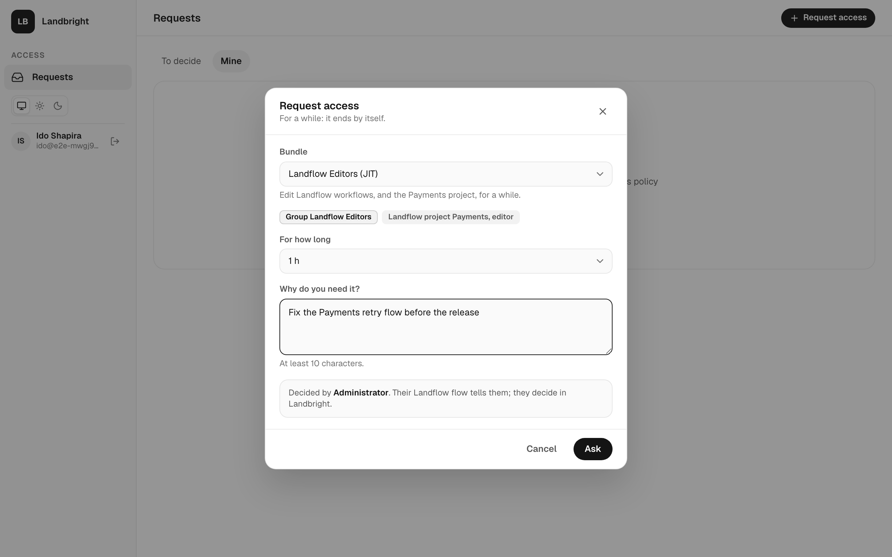
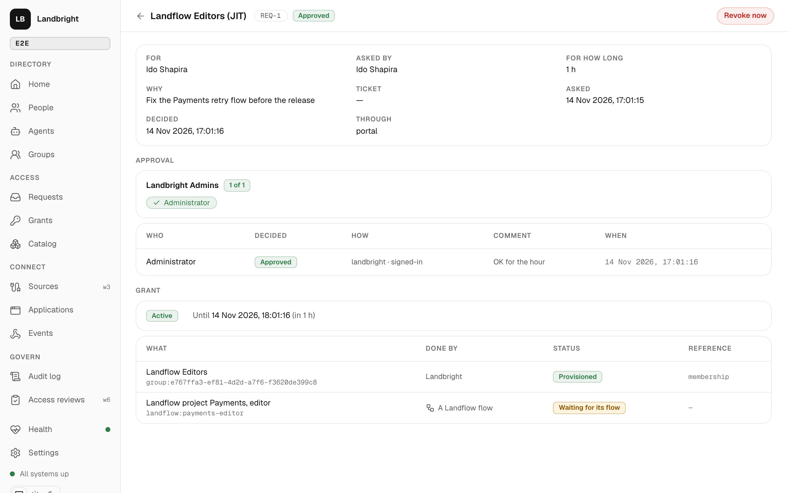
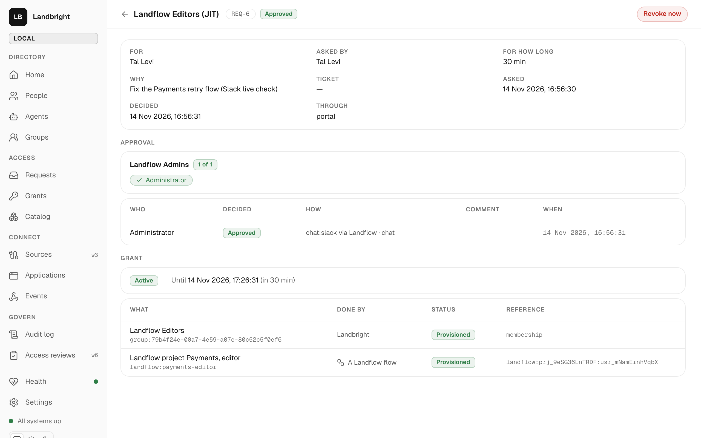
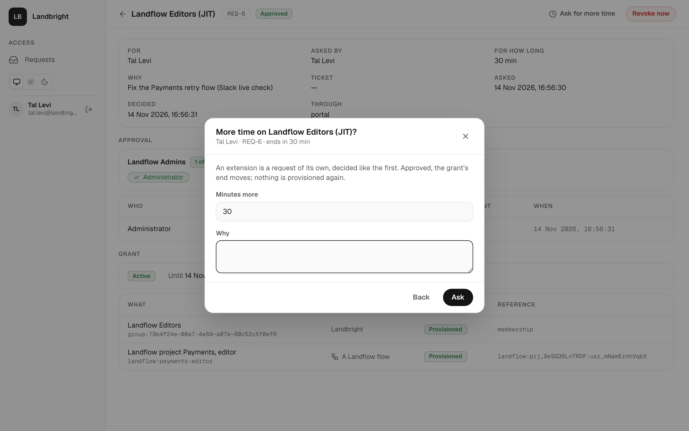
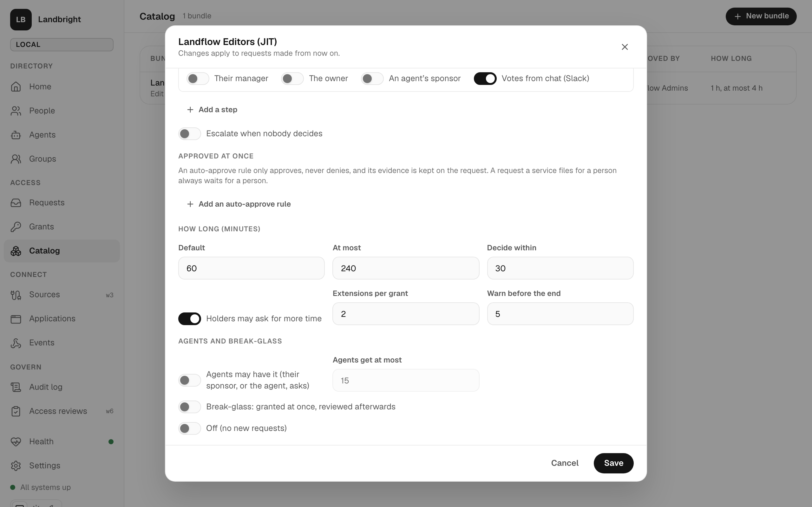

# Just-in-time access

People ask for **bundles** for a while. The people the bundle's **policy** names approve in Landbright, and a **grant**
gives the access and takes it back at the end. Landflow flows run the conversation around it: they tell the
approvers, provision what Landbright can't, and report back. The decision itself never leaves Landbright
([spec 004](../specs/004-access-and-events/spec.md); the flows are in [landflow-flows.md](landflow-flows.md), the
events in [events.md](events.md)).



## Bundles and policies

A bundle (console **Catalog**, `POST /api/bundles`) gives:

- **Groups**: Landbright adds the holder to them for the grant, with `source: grant` and the grant's end, and removes
  them at the end. Applications see the group in the `roles` claim as usual.
- **Targets**: anything else, such as a Landflow project role or a GitHub team. Each has a `key`, a `type`, a `label`
  and a `config` the flow reads. A Landflow flow subscribed to `grant.*` provisions each one and reports back.

Its **policy**:

| Field | Meaning |
|---|---|
| `eligibleGroupIds` | Who may ask: standing members of these groups (empty: every active person) |
| `agentsAllowed`, `agentMaxDurationMinutes` | Whether a sponsor may ask for one of their agents, and how long an agent gets at most (15 min by default) |
| `steps[]` (1–3) | In order. Each names approvers (`groupIds`, `identityIds`, `manager`, `bundleOwner`, `sponsor`) and `approvalsRequired`, and whether its approvers may also vote from a chat (`allowRelayed`, off by default) |
| `approverFallback` | When a step names nobody but the requester: `bundleOwner`, then `admins`. Still nobody: the request is refused when it's made |
| `defaultDurationMinutes`, `maxDurationMinutes` | How long, and at most; the duration is clamped again at approval |
| `decisionDeadlineMinutes` | An undecided request expires (`request.decided`, outcome `expired`) |
| `expiringNoticeMinutes` | `grant.expiring` goes out this long before the end |
| `reason` | `required` or `optional`, with a prompt and a minimum length |
| `ticket` | `off`, `optional` or `required`, with a pattern; `uniquePerRequest` stops a ticket from being reused |
| `autoApprove[]` | Rules that approve at once: the subject is a standing member of one of these groups, asks for at most this long, and (with `window`) asks within set days and hours in a time zone. Never deny. The rule and its evidence are kept on the request. A request a service files for a person is never auto-approved |
| `extensions` | Whether a holder may ask for more time (default yes), and how many times per grant (`maxCount`, default 2) |
| `breakGlass` | Members of these groups may take it at once for at most `maxDurationMinutes`; the approvers review it afterwards |
| `escalation` | After this long without a decision, these groups' people join the current step (`request.escalated`) |

## The rules of a decision

- **People vote**, on the request page (`/access/requests/REQ-n`, the link every flow sends), signed in. Where a step
  allows it, also **from a chat**: a flow asks Landbright for one ticket per approver, hands each in a direct message,
  and relays the click with it (below). A service token never gets `decide`, and a flow can't choose who voted.
- A voter must be named by the current step **now**, through a **standing** membership. A membership a grant gave
  doesn't count, so access can't approve more access.
- Nobody votes on a request they made, or one that's for them or that they act for. One vote per person.
- **One denial ends the request.** Approvals count per step, and the request is approved when every step has
  enough.
- A new request for the same bundle and subject replaces a waiting one (`superseded`). A live grant refuses a new
  request.
- Deactivating a person ends their grants and cancels their requests, and does the same for the agents they sponsor.



### Votes from a chat

A ticket is a short-lived JWT signed with the issuer's key: this approver, this request, this step, until the
deadline. The flow's buttons carry it; a click comes back to the flow, which posts it to
`POST /api/v1/requests/:id/decisions`. Landbright checks the ticket, then every rule above, and records the vote as the
approver's with `channel: chat:slack`, `assurance: chat` and the flow as `submittedBy`. Its use: approving from Slack
without opening the console. Its limit: whoever holds the flow's token and a ticket could vote, so it's off unless a
step turns it on, and the decision page stays the stronger path.



## Asking for more time

**Ask for more time** on a live grant (or `POST /api/access/grants/:id/extend`) files an extension: a request with
`extends`, decided by the same steps and auto-approve rules. Approved, the grant's end moves by the extension's
duration and so do its group memberships; `grant.expiring` can go out again; flows see `grant.extended` and provision
nothing new. If the grant ends before the extension is decided, approving it gives a new grant.



## Requests a service files

With `requests:create`, an application files requests on the machine API:

- **For an agent**: the agent is the requester, its sponsor is `actingFor` and can't approve it, eligibility is the
  sponsor's, and the bundle must allow agents (at most `agentMaxDurationMinutes`). An agent's own application asks only
  for that agent.
- **For a person** (an intake flow, a Slack command): eligibility is theirs, and the request always waits for a person
  to decide it, whatever the auto-approve rules say.

## Grants and targets

A grant is `scheduled` (with `startsAt`), `active`, then `expired` or `revoked`. Each target has a status:

| Status | Meaning |
|---|---|
| `pending` | Waiting for its flow |
| `provisioned` / `failed` | The flow gave it, or couldn't (`lastError`); a failed one may be retried |
| `verified` / `drift` | A reconciling flow checked it |
| `revoked` / `revoke_failed` | After the end, the flow removed it, or couldn't |

Landbright handles group targets itself. When a group membership already existed, it is left alone (`already-member`).
When two live grants give the same group, the membership is handed to the other grant (`shared-with-grant`). A late
`provisioned` after the end gets 409. A flow that hasn't reported a removal 15 minutes after the end raises
`grant.revoke_overdue`.

Tokens end with the grant: an access token or ID token issued to someone holding a just-in-time group lives no longer
than the soonest such membership (at least 30 seconds), so `roles` in a token is never older than the grant behind it.

## In the console

- **Requests** (everyone): *To decide*, *Mine*, and *All* for administrators; **Request access** shows who would
  decide before you ask.
- **Grants**, **Catalog** (administrators): who holds what until when, and the bundles with their whole policy: every
  step, auto-approve rules with hours, escalation, extensions, agents and break-glass.



People who aren't administrators see only Requests; other pages say they're for administrators.

## For flows: the machine API

`/api/v1`, with a client-credentials token for the resource `urn:landbright:api`. An application gets scopes on its
page (`apiScopes`). The routes are in [reference/api.md](reference/api.md#machine-api-apiv1).

```bash
curl -s -u landflow-local:$SECRET -d grant_type=client_credentials \
  -d resource=urn:landbright:api -d scope='requests:read grants:record' http://localhost:4402/oidc/token
```
