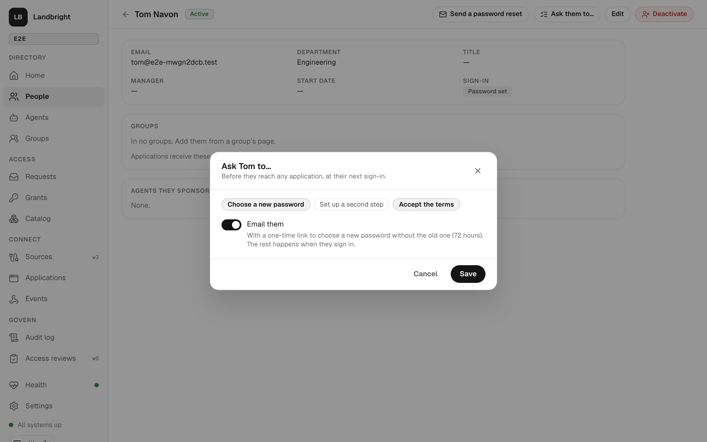
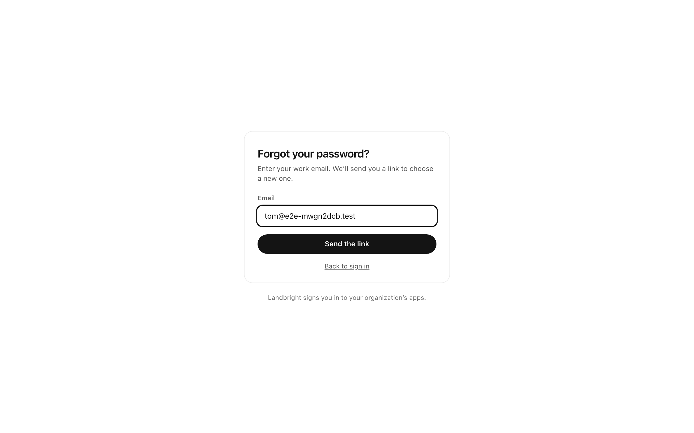
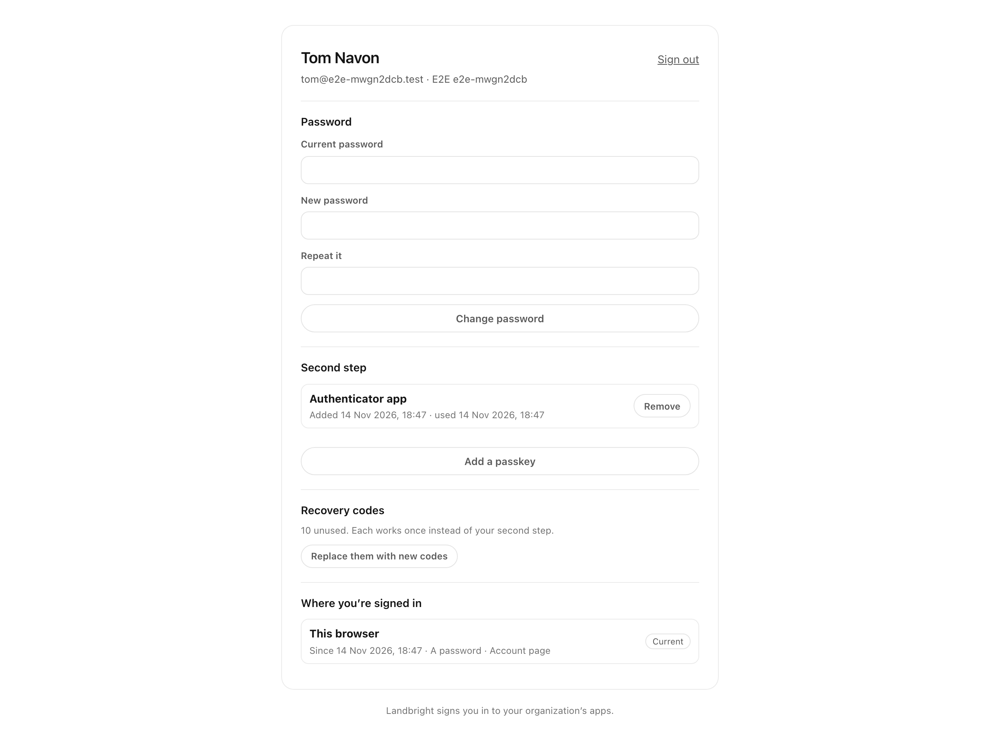
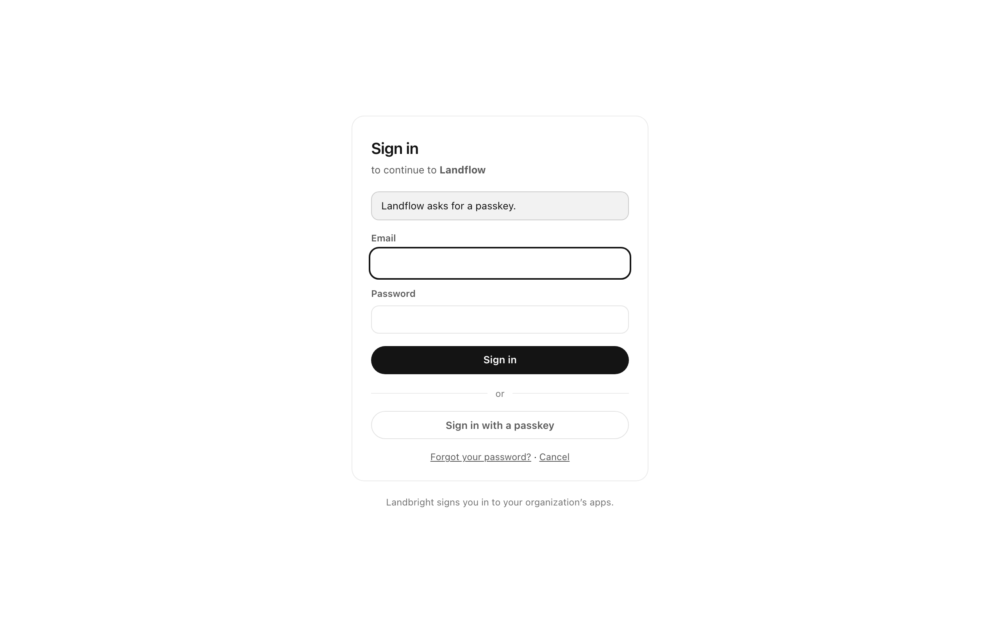

# Your account, and what sign-in asks of you

The identity plane's self-service pages and the rules an application or an administrator can set on a sign-in
([spec 005](../specs/005-follow-ups/spec.md), slice 2, from the [Keycloak study](../specs/004-access-and-events/research/keycloak-study.md)): required actions, a
forgotten password, the account page, recovery codes, and how strong a sign-in an application needs (`acr`). The
pages are the identity plane's own (`apps/idp/src/account`, `apps/idp/src/pages/account-pages.ts`), under the same CSP
as the sign-in pages: no inline styles, one content-hashed script for passkeys.

## Required actions

Something a person must do at their next sign-in, before they reach the application (Keycloak's *required actions*):

| Action | What they see |
|---|---|
| `update_password` | *Choose a new password*: at least 12 characters, not the one they just used. |
| `configure_second_step` | The second-step setup page, without *Not now*. Done once they have an authenticator app or a passkey, however they got it. |
| `accept_terms` | *Before you continue*: a checkbox, and a link to `LANDBRIGHT_TERMS_URL` when it is set. Recorded as `termsAcceptedAt`. |

An administrator sets them on the person page (*Ask them to…*, which replaces the list; *Email them* sends a mail, with
a one-time link to choose a password when `update_password` is among them), or a flow does through the machine API
(`POST /api/v1/people/:id/required-actions`, `directory:write`). Each is done in order after the password and second
step; the sign-in finishes only when none is left. Audited: `identity.required_actions_set`, then
`credential.password_set` and `identity.terms_accepted` as the person does them.

## Forgot your password

The sign-in page links to `/forgot`. Whatever the address, the answer is the same (*Check your email*), and it comes
back before the mail is sent, so a known address doesn't answer more slowly. For an active person, the mail holds a
link to `/reset/<token>`: 30 minutes, once, only the token's SHA-256 stored; asking again cancels the earlier link.
At most 3 links an hour per address and 10 requests per 15 minutes per client address (Valkey; fails open, like the
sign-in lockout). Choosing the new password ends every session of theirs (`credential.password_reset`).

## The account page

`<IDP_URL>/account`. The person signs in through Landbright's own `landbright-account` client (static in the provider,
response type `none`), so the page uses the identity plane's session itself; signing out there ends it.

- **Password**: change it with the current one.
- **Second step**: the authenticator app and passkeys, with when each was added and last used; add an app (QR code),
  add a passkey, remove one. The last one can't be removed when the tenant requires a second step; removing the last
  one also removes the recovery codes.
- **Recovery codes**: ten, `xxxx-xxxx-xxxx`, shown once; creating new ones cancels the old. Only their SHA-256s are
  stored.
- **Where you're signed in**: each session, when it began, how strong it was and the apps it signed in to; *Sign out
  everywhere else*.

Every form carries a CSRF token (an HMAC of the session id), except the authenticator code, which must match a key only
this session's page was given. Changing the password needs the current one; changing the second step or the recovery
codes needs a sign-in within the last 15 minutes; otherwise the page asks for one again (`max_age=0`) and comes back.
Audited as the person: `credential.password_set`, `credential.removed`, `credential.recovery_codes_created`,
`session.others_ended`.

## Recovery codes at sign-in

On the second-step page, *Use a recovery code* takes one instead of the code or passkey. It works once (deleted when
used, `credential.recovery_code_used`), counts toward the lockout when wrong, and the sign-in says
`amr: ["pwd", "otp", "mfa"]`.

## How strong a sign-in (`acr`)

The ID token carries `acr` next to `amr`:

| `acr` | Means | From `amr` |
|---|---|---|
| `urn:landbright:acr:pwd` | A password | `pwd` alone |
| `urn:landbright:acr:mfa` | A password and a second step | has `mfa` |
| `urn:landbright:acr:phr` | A passkey (phishing-resistant) | has `pop` |

An application asks for more in two ways, and gets the stronger of the two:

- **Its minimum** (*Sign-in needs* on the Applications page, `minimumAcr` in the API).
- **`acr_values`** on the authorization request: the weakest of the values it names that Landbright knows.

When the existing session is weaker, the provider asks again (a login prompt with reason `acr_too_low`) and the page
says what the application needs: a second step even for someone who chose *Not now*, or a passkey (someone without one
is told so, and goes back). Discovery lists the three values in `acr_values_supported`.

## The *Onboard* flow

Landflow's sixth flow ([landflow-flows.md](landflow-flows.md)) takes `identity.created` for a person and does what
Keycloak's onboarding does: adds them to the birthright groups for everyone and their department (source `hr`, through
`POST /api/v1/groups/:id/members`), asks them to set up a second step and accept the terms at their first sign-in, and
emails a welcome. The machine API never adds anyone to *Landbright Admins*.
