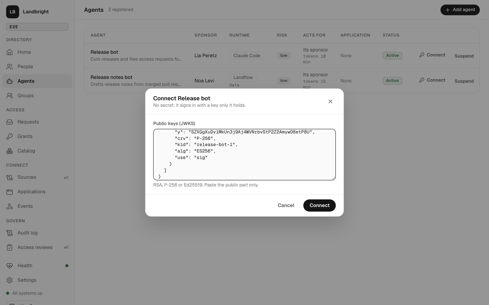
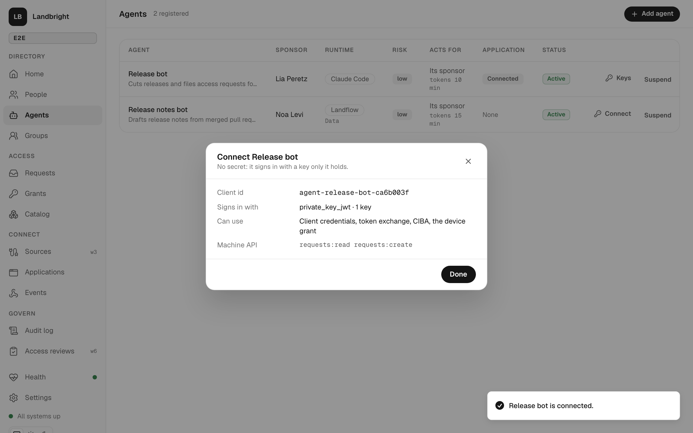
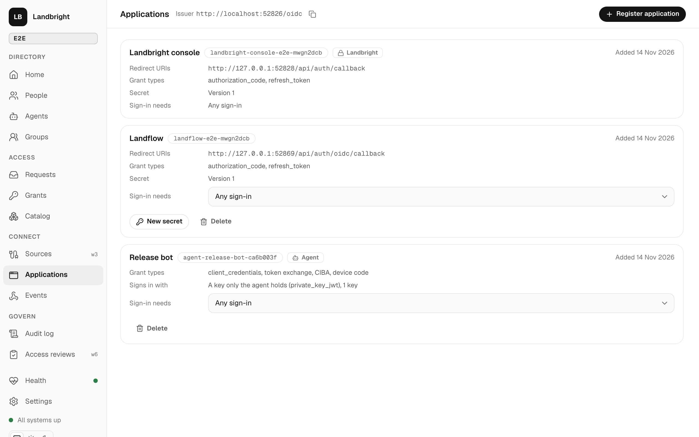
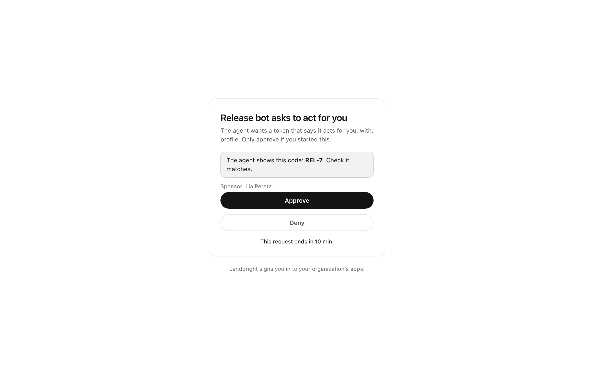
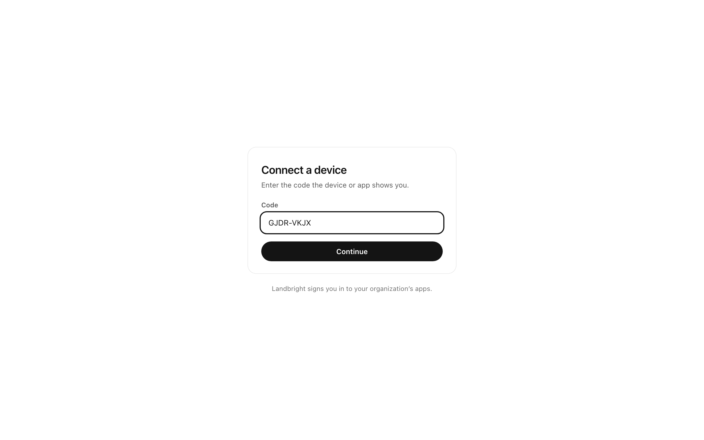
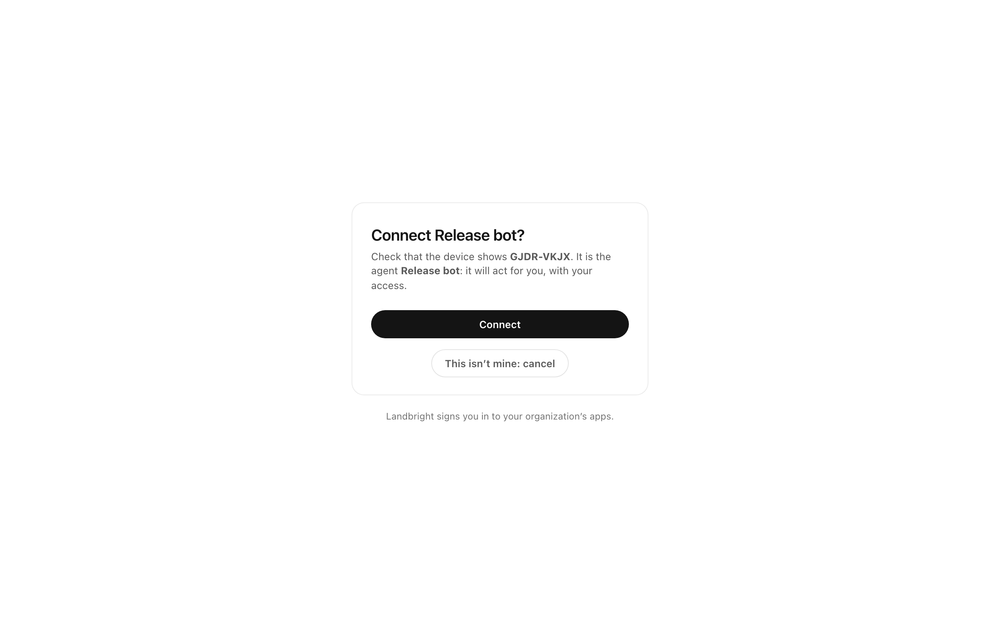

# Agents: their own application, and acting for a person

An agent in the directory ([directory.md](directory.md)) is an identity with a sponsor, a purpose, a risk tier, a
longest token (`maxTokenTtlSeconds`) and a rule for whom it may act for (`actFor`: anyone, its sponsor, or nobody).
[Spec 005](../specs/005-follow-ups/spec.md), slice 3 (T012–T015, from the [Keycloak study](../specs/004-access-and-events/research/keycloak-study.md))
gives it a way to get tokens of its own and to act for a person, with that person's say-so:

| What | Standard | The agent gets |
|---|---|---|
| Its own application | `private_key_jwt` (RFC 7523) | A client with its public keys: no secret to leak or rotate. |
| Tokens as itself | Client credentials | A machine API token, as the agent. |
| Act for a person it already has a token for | Token exchange (RFC 8693) | A token that says so: `act: { sub: <agent>, client_id }`. |
| Ask a person, out of band | OpenID CIBA, poll mode | Tokens for the person, once they approve on Landbright's page. Landflow tells them. |
| Ask a person at a terminal | Device grant (RFC 8628) | Tokens for the person, once they type the code and confirm. |
| Hardening | PAR (RFC 9126), DPoP (RFC 9449) | Authorization requests sent ahead; tokens bound to a key. |

Nobody but the person decides that an agent acts for them (constitution principle IV): not the agent, not Landflow's
flow, not an administrator.

## Connecting an agent

Agents → *Connect* on the agent's row, paste its public keys (a JWKS: 1 to 5 RSA, EC or OKP keys; a private part is
refused), *Connect*. Landbright makes the agent's own application:

- client id `agent-<name>-<first 8 of its id>`, `token_endpoint_auth_method: private_key_jwt`, no secret, no redirects;
- grant types: client credentials, token exchange, CIBA and the device grant (the API can choose fewer);
- machine API scopes: `requests:read requests:create` (the API can choose others).

*Keys* replaces the keys later; the old ones stop working at once (`client.keys_replaced`). The application is listed
on Applications with an *Agent* badge; its grant types, redirects and auth method are set with it and can't be edited
there, and it has no *New secret*.

The application exists only while the agent and its sponsor are active: suspend the agent, or deactivate the sponsor,
and its client authentication fails (`invalid_client`), and the machine API refuses its tokens at once.

The agent proves itself with a client assertion signed by its private key (`iss` = `sub` = the client id, `aud` = the
issuer, a fresh `jti`, a short `exp`).

## Tokens

Every token an agent's application gets lasts at most the agent's `maxTokenTtlSeconds`, and less where the rules below
say so. Every token it holds for a person says so: `act: { sub: <agent id>, client_id }` (in the JWT, or in
introspection for an opaque token).

**As itself.** `grant_type=client_credentials&resource=urn:landbright:api`: a machine API token at most 10 minutes
long, with the application's scopes. What it files is the agent's: its sponsor is `actingFor` and can't approve.

**For a person: token exchange.** `grant_type=urn:ietf:params:oauth:grant-type:token-exchange` with
`subject_token` (a person's access token from Landbright: an opaque one from CIBA, the device grant or a sign-in, or a
JWT from an earlier exchange) and `subject_token_type=urn:ietf:params:oauth:token-type:access_token`.

- Only an agent's application, and only for a person its `actFor` allows (`invalid_grant`: *Release bot acts only for
  its sponsor.*); the person must be active.
- Audience: the machine API by default (scopes: what the application holds), or another application's client id as
  `audience` (scopes: what the person's token had, never `offline_access`). One audience.
- Lifetime: the shortest of the agent's longest token, what is left of the person's token, and an hour (at least 30
  seconds left, or it is refused).
- `act` names the agent; exchanging a token that already has an `act` from another actor nests it
  (`act: { sub, client_id, act: {…} }`), and re-exchanging the agent's own adds nothing.
- `actor_token` isn't used (the agent is the actor) and a sender-constrained subject token (DPoP or mTLS) is refused.
- On the machine API, the token acts for the person: what it files is theirs, with the agent named as the one who
  asked (`Release bot for Lia Peretz`).
- Audited `token.exchanged` (the agent, the person, the audience, the scope, `act`, the lifetime).

## Asking a person: CIBA, with Landflow as the channel

The agent posts to `/oidc/backchannel` with `login_hint=<the person's email>`, a `scope` and a `binding_message` (a
short code it also shows), and polls `/oidc/token` with `grant_type=urn:openid:params:grant-type:ciba` and the
`auth_req_id`.

1. Landbright checks the agent may act for the person (`access_denied` if not; `unknown_user_id` for no active person
   with that email) and records `ciba.requested` with the link to the decision page, the agent, the person, the scope,
   the binding message and when it ends (10 minutes).
2. Landflow's flow *Ask a person for an agent (CIBA)* ([landflow-flows.md](landflow-flows.md)) gets the event and emails
   the person: *Release bot asks to act for you*, the code, the link. The flow carries the link; it can't decide.
3. The person opens the link, signs in to Landbright if they aren't already (the second step and required actions as
   usual), sees the agent, the scope, the code to compare and the sponsor, and approves or denies.
4. The agent's next poll gets tokens for the person (with the sign-in's `amr`, `acr` and `auth_time`), or
   `access_denied`. Audited `ciba.approved` / `ciba.denied`.

Someone else who opens the link sees *Not yours* (403). `login_hint_token` isn't supported; `user_code` is ignored
(the person signs in instead).

## Asking a person at a terminal: the device grant

The agent posts to `/oidc/device/auth` and shows the person `user_code` (eight letters, `XXXX-XXXX`) and
`verification_uri`, then polls `/oidc/token` with `grant_type=urn:ietf:params:oauth:grant-type:device_code`. The person
opens `/oidc/device`, signs in, types the code, and sees *Connect Release bot?*, which says it is an agent and will act
for them. *Connect* gives the agent tokens for them; *This isn't mine: cancel* refuses. An agent that may not act for
the person is refused after sign-in (*Not connected: Release bot acts only for its sponsor.*). The codes last 10
minutes.

## PAR and DPoP

Pushed authorization requests (`/oidc/request`) work for every client: the request goes to Landbright first and the
browser carries only a `request_uri`. Not required.

DPoP works at the token endpoint for every client (`DPoP` header, ES256 or EdDSA): the token is bound to the key
(`cnf.jkt`). The machine API then wants `Authorization: DPoP <token>` and a proof for each call (`htm`, `htu`, `ath`,
`iat` within 5 minutes, each `jti` once); a bound token sent as `Bearer`, or without a proof, is refused.

## Checked

- `e2e/test/agents.test.ts` (11 tests against the built services): client credentials with `private_key_jwt` and a
  forged key; exchange with `act`, re-exchange, another audience; the refusals; CIBA approved, denied, refused, unknown
  person; the device grant and its refusal; PAR; DPoP; suspending the agent.
- `pnpm screenshots`: screens 80–85 above.
- Live, 2026-11-14, in the dev Landbright and the throwaway Landflow (`landbright-landflow`): Landflow's flow emailed
  *Release bot … asks to act for you*; Rina (a new person; Landflow's *Onboard* flow had set her required actions) did
  them, saw the code and approved; the agent polled tokens, exchanged them (`act` = the agent, 10 minutes) and called
  the machine API. Two bugs found and fixed there: the email said the link worked for 1 minute (the request's `exp`
  isn't set yet when Landbright is told; it now uses its lifetime), and re-exchanging the agent's own token nested a
  second, identical `act`.

What isn't built is in [limitations.md](limitations.md#agents-spec-005-slice-3).
