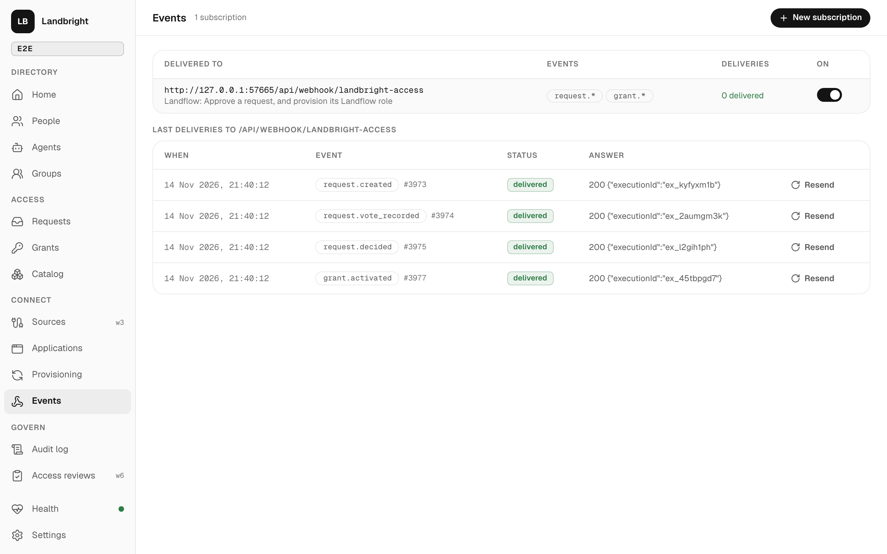

# Events

Every change Landbright makes is an audit event, and every audit event can go out: identities, sessions, credentials,
groups, applications, bundles, requests, grants. This is Landbright's answer to Keycloak's event listeners, which run
after commit with no retry ([Keycloak study](../specs/004-access-and-events/research/keycloak-study.md)). It is what
lets lifecycle and access processes be Landflow flows.



## Subscriptions

Console **Events** or `POST /api/events/subscriptions`: a URL (usually a Landflow Webhook trigger's production URL),
the event types or prefixes (`request.created`, `grant.*`, `group.member_*`, `*`), an audience, and optionally
`replay` (start N audit events back, to try a new flow). Turning a subscription off pauses it; turning it back on
continues where it stopped.

## Delivery

```
POST <url>
Authorization: Bearer <JWT>
Idempotency-Key: <tenant>.<audit id>
webhook-id: <tenant>.<audit id>
Content-Type: application/json

{ "id", "type", "at", "actor": { id, label }, "target": { type, id }, "data": { … } }
```

- The JWT is a Security Event Token (`typ: secevent+jwt`), signed RS256 with Landbright's current signing key.
  - Header: `kid` is the signing key's.
  - Claims: `iss` (the issuer), `aud` (the subscription's audience, by default the URL's origin), `iat`, and `exp`
    (5 minutes later).
  - Also: `jti` (the event id), `sub` (the target's id), `toe`, `type`, `tenant`, `event` (the body above) and
    `events`.
  - The receiver checks it against `<issuer>/jwks`. Landflow's Webhook trigger does that with a *JWT Auth* credential
    of key type *JWKS*, so no secret is shared.
- `data` is the audit data. Request, grant and identity events also carry the current `request`, `grant` or `identity`,
  so a flow often needs no read. Flows should still re-read before acting: the event may be old by then.
- **At least once.** Each subscription keeps a cursor over the audit log, so an event goes out only if its transaction
  committed, and none is skipped. A failed POST (non-2xx, timeout after 10 s, a redirect) is retried after 5 s, 10 s,
  20 s… up to an hour apart, for 24 hours, then marked failed. A receiver drops repeats by `Idempotency-Key`, as
  Landflow's webhooks do.
- The response is kept on the delivery: Landflow answers with the `executionId` of the run it started. **Resend**
  sends a delivery again.

The worker that sends them runs in control every 2 seconds, one replica at a time (a Valkey lock), unless
`LANDBRIGHT_WORKER=off`.

## Waking a waiting flow

A flow that waits for a decision registers its resume URL: `POST /api/v1/requests/:id/waits { resumeUrl }`. The URL
must be on the origin of an enabled subscription. When a vote is recorded, the request is decided or it escalates,
Landbright POSTs that URL. The POST carries nothing: it is a nudge, and the flow re-reads the request. A nudge that
fails is tried again with the deliveries' back-off for a day (a new wait from the flow replaces it); a lost one costs
only time, because the flow's Wait also ends at the decision deadline.

## An application's own subscriptions

With `events:manage`, an application lists, adds and removes its own subscriptions on the machine API
(`/api/v1/subscriptions`), only at an origin among its redirect URIs, so a token can't point Landbright anywhere else.
They show in the console's Events with the application as owner (`ownerClientId`).

## Event types

`GET /api/events/subscriptions` lists them (`eventTypes`):

- `identity.*` (created, updated, invited, deactivated, reactivated)
- `session.signed_in`, `session.sign_in_failed`
- `credential.*`
- `group.*` (including `member_added` / `member_removed`)
- `client.*`
- `bundle.*`
- `request.*`: created, vote_recorded (with `channel` and `assurance`), decision_refused, escalated, break_glass,
  relay_tickets_issued, decided
- `grant.*`: activated, expiring, extended, expired, revoked, target_provisioned, target_failed, target_revoked,
  target_revoke_failed, target_verified, target_drift, revoke_overdue
- `tenant.sign_in_changed`, `signing_key.rotated`
- `provisioning.*` ([provisioning.md](provisioning.md#in-the-ledger)): user_created, user_linked, user_updated,
  user_deactivated, group_created, group_linked, group_updated, group_deleted, push_failed, and target_created,
  target_updated, target_deleted, target_token_replaced, target_sync_requested
