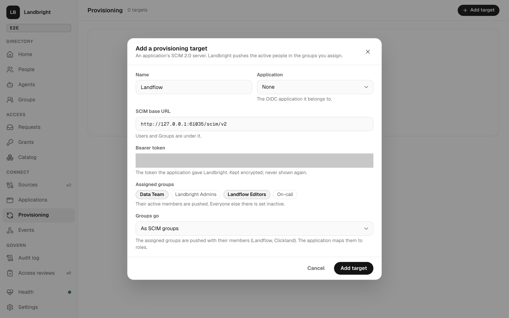
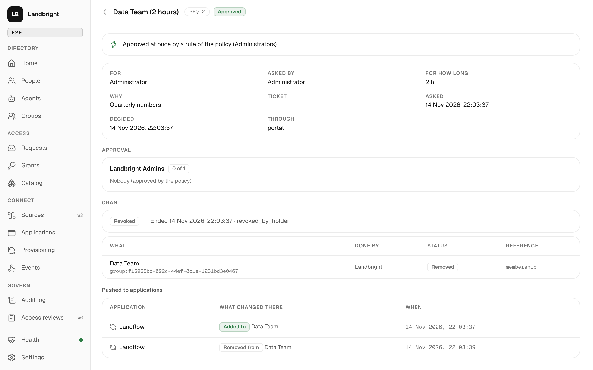
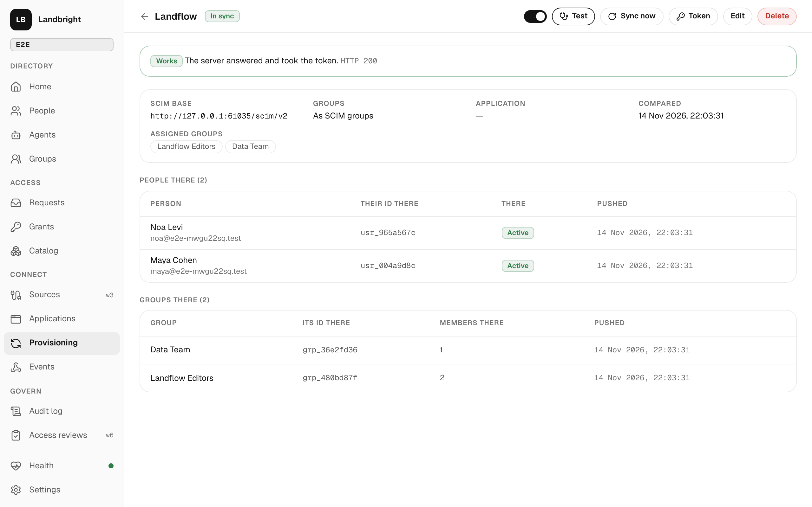
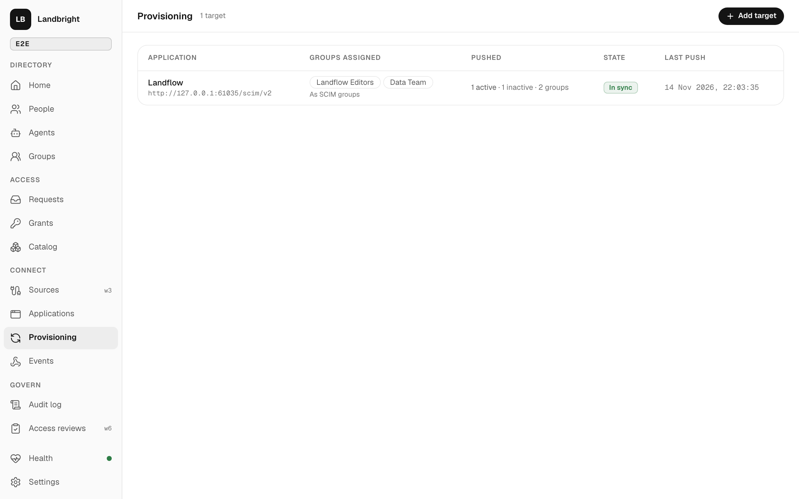
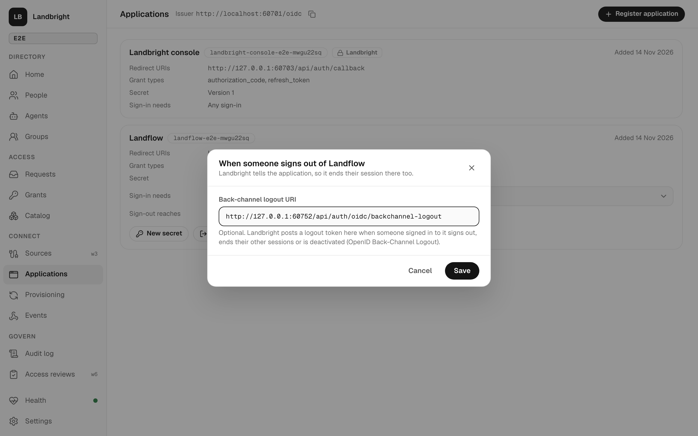

# Provisioning: keeping applications in step (SCIM)

Landbright is the SCIM 2.0 client ([RFC 7644](https://www.rfc-editor.org/rfc/rfc7644)) that Okta or Entra would
otherwise be. For each application whose SCIM server it is connected to, it pushes the people in the groups assigned
to it and, where the application stores groups, the groups with their members. A change in Landbright reaches the
application within seconds; deactivating a person sets them inactive there, which signs them out.
[Spec 006](../specs/006-provisioning-out/spec.md), wave 2.

| Application | SCIM base | Groups | `active: false` there |
|---|---|---|---|
| Landflow | `<Landflow>/scim/v2` | As SCIM groups; `LANDFLOW_SCIM_GROUP_MAP` turns them into roles and project memberships | Deletes their sessions at once |
| Landfall | `<core-api>/scim/v2/<org>` | On each person (`groups`): Landfall picks a role from them and stores no groups | Membership deprovisioned, OpenFGA tuples deleted: its routes refuse at once (see [limitations](limitations.md#provisioning-spec-006)) |
| Clickland | `<api>/scim/v2` | As SCIM groups: *Clickland Admins*, *Editors*, *Viewers* map to its admin, editor and viewer roles | Ends their sessions at once |

## Connecting an application

Console → **Provisioning** → *Add target*:

- **Name**, and the OIDC **application** it belongs to (optional, for the record).
- **SCIM base URL**: the URL that `/Users` and `/Groups` hang off.
- **Bearer token**: the token the application gave Landbright. It is sealed with `LANDBRIGHT_SECRET_KEY` (AES-GCM) and
  never shown again; *Token* replaces it.
- **Assigned groups**: their active members are pushed.
- **Groups go** *As SCIM groups* (Landflow, Clickland) or *On each person* (Landfall).

*Test* asks the server for `/ServiceProviderConfig` and for a user that doesn't exist, and says whether it answered and
took the token. A new target pushes everything in scope within seconds; it doesn't replay older history.

Getting a token:

- **Landflow**: Settings → Security → SCIM, or as an admin `POST /api/api-keys {"label": "Landbright SCIM", "scopes":
  ["scim"]}` (the token has the `scim` scope only). Landflow needs nothing switched on.
- **Landfall**: as an org admin, `POST /o/<org>/scim/enable` (or Settings → Sign-in and SSO → SCIM provisioning); the
  token is shown once. The org's plan needs the `scim` entitlement.

## Who is pushed, and how

A **person** is in scope when they are `active` and in at least one assigned group. Agents aren't pushed (wave 5).

| Landbright | The application |
|---|---|
| A person comes into scope | `POST /Users`: `userName` and `emails` = their email, `externalId` = their id (the `sub` of their ID token), `displayName`, `name`, `active: true`, and *On each person* `groups` |
| They already have an account there (from signing in, or made by hand) | The 409 is answered by finding it (`userName eq`, then `externalId eq`) and adopting it with a `PATCH` that sets everything; Landfall's create is create-or-link anyway |
| Renamed, email changed, groups changed | `PATCH` with `replace` of what changed: the attributes as one path-less value, `groups` with its path |
| Deactivated, suspended, or out of every assigned group | `PATCH active: false` (never `DELETE`) |
| Back in scope | `POST` again (Landfall re-links its sign-in only on create); Landflow answers 409 and is patched |
| A **group** assigned (*As SCIM groups*) | `POST /Groups` with `externalId` and its active, pushed members; a group of that name already there is adopted |
| Members join or leave | `PATCH` with one `add` of members and a `remove` of each one leaving (`members[value eq "…"]`) |
| Renamed | `PATCH replace displayName` (the application's map is by name, so check it) |
| Unassigned from the target, or deleted | `DELETE /Groups/:id` |

**Just-in-time access** comes for free: a grant adds a membership to a group ([access.md](access.md)), and if that
group is assigned to a target the membership is pushed, and removed when the grant ends. In Landflow, *Data Team* in
`LANDFLOW_SCIM_GROUP_MAP` as `Data Team=project:Data:editor` makes the holder editor on the *Data* project for as long
as the grant lasts, with no flow.

The request's page shows what reached the applications under the grant (*Pushed to applications*): each push that
added the holder to one of its groups there, and each that removed them, with the target and the time. It is read from
the audit log (`provisioning.group_*` events whose `added` or `removed` name the holder, and in *On each person* mode
the person's `provisioning.user_*` events, which carry `groupsAdded` and `groupsRemoved`), so it costs no extra
bookkeeping; `AccessRequestView.grant.pushes` has it for flows too.

## Within seconds, and until it lands

The audit log is the outbox, as for [events](events.md): each target reads it from its own cursor in the event worker's
loop (every 2 seconds, one replica at a time under the worker's Valkey lock) and queues the people and groups that
changed: one job per person or group, however many changes. People are pushed before groups, so a group's new member
exists there when the group is patched. A push that fails is tried again after 5 seconds, then 10, 20 … at most an hour
(or the server's `Retry-After`), until it succeeds; the target shows *Failing* with the error, and its page lists what is
queued and why.

Every 15 minutes, when the target is changed, and on *Sync now*, everything in scope or pushed before is compared with
what the application holds (`GET /Users/:id`, `GET /Groups/:id`): someone made active by hand there is set inactive
again, a member added by hand is removed, a person or group deleted there is created again.

## In the ledger

Every push that changes something is an audit event, so a Landflow flow can subscribe to it
([events.md](events.md#event-types)):

| Event | When |
|---|---|
| `provisioning.user_created`, `provisioning.user_linked` | A person created there, or an existing account adopted |
| `provisioning.user_updated` | Attributes or groups changed, or reactivated (`reactivated`); `drift: true` when reconciliation found it |
| `provisioning.user_deactivated` | Set inactive there, with `why` (`deactivated`, `suspended`, `not in an assigned group`) |
| `provisioning.group_created`, `provisioning.group_linked`, `provisioning.group_updated`, `provisioning.group_deleted` | A group pushed, adopted, changed (`added` and `removed` as Landbright ids, and `grants`: the grants behind the additions), or deleted there |
| `provisioning.push_failed` | The first failure of a job, with the error and when it is tried again |
| `provisioning.target_created`, `_updated`, `_deleted`, `_token_replaced`, `_sync_requested` | An administrator changed the target |

Deleting a target leaves the application as it is: its people and groups stay there, no longer kept in step.

## Back-channel logout: ending a session in an application that isn't a target

SCIM keeps the applications Landbright provisions in step. Any application, provisioned or not, can also be told when
someone's session ends, by OpenID Back-Channel Logout 1.0: give it a *Back-channel logout URI* (Applications →
*Sign-out*, or `backchannelLogoutUri` on the API), and Landbright posts it a logout token when someone who signed in to
it through Landbright:

| Happens | The logout token |
|---|---|
| Signs out at Landbright (`/oidc/session/end`, *Sign out* from any application) | One for that session (`sid`) |
| Ends their other sessions on the account page, or resets their password | One per session ended |
| Is deactivated | One per session, and one with no `sid` (every session) for each application they hold a grant with but no session at Landbright any more: its own session outlives Landbright's |

The token is a JWT signed with the issuer's key (`typ: logout+jwt`, RS256), with `iss`, `aud` (the client id), `iat`,
`exp` (two minutes), `jti`, `sub`, `sid` and the back-channel logout event, and no `nonce`, posted as
`logout_token=<JWT>` (`application/x-www-form-urlencoded`). The application checks it against the JWKS, as it checks an
ID token, and ends the session whose `sid` its ID token carried (the ID token carries `sid` for an application with a
URI). Discovery says `backchannel_logout_supported` and `backchannel_logout_session_supported`.

The logouts are queued in the same transaction as what ended the sessions (`logout_delivery`), and the event worker's
loop sends them: 200 or 204 is delivered; anything else is tried again after 5 seconds, then 10, 20 … ten tries in all
(about 85 minutes), then given up. Each delivery is in the ledger, `session.logout_sent` (with `reason`: `signed_out`,
`sessions_ended` or `deactivated`) or `session.logout_failed` (on the first failure, and when given up). oidc-provider's
own sign-out sends its logout tokens through the same queue, not inline.

## Checked

- `apps/control/test/scim.test.ts`: the operations (what is sent from what was pushed) and the client (errors,
  `Retry-After`, 404 and 400 answers).
- `e2e/test/provisioning.test.ts` (11 tests against the built services and two fake servers shaped like Landflow's and
  Landfall's, `e2e/test/fake-scim.ts`): create and adopt, *Test*, deactivation ending the sessions (under 6 seconds),
  reactivation, leaving scope, a rename, a just-in-time grant and its revocation, a group renamed and unassigned, a
  server failing then recovering, reconciliation of a change made there, the Landfall shape (groups on the person,
  re-created on reactivation), administrators only.
- `apps/control/test/logout.test.ts`: logout token claims, the sessions read, the back-off.
- `e2e/test/backchannel-logout.test.ts` (4 tests, a stand-in application that verifies each token against the JWKS):
  discovery, signing out at Landbright, *Sign out everywhere else*, deactivation with a refused first delivery tried
  again.
- `provisioning.test.ts` also reads the grant's pushes (added, then removed on revocation).
- Browser: screens 86–89 and 12a.
- Live, 2026-11-14, the dev Landbright and the throwaway Landflow (`landbright-landflow`, with
  `LANDFLOW_SCIM_GROUP_MAP`): six people and three groups in sync within a second, Tal's existing account adopted; Tal
  signed in to Landflow through Landbright, was deactivated in Landbright, and **Landflow's session ended 1.3 seconds
  later**; Tal reactivated; a *Data Team* grant approved in Landbright made Tal editor on Landflow's *Data* project
  1.6 seconds later (`source: scim`), and revoking it removed them 1.4 seconds later.
- Live, the same day, Clickland's and Landfall's own servers (built and switched on by the Clickland session):
  Clickland in sync in under 2 seconds (six people, its three role groups, Tal's account from a first sign-in
  adopted); Landfall's `clickland-it` org with *Landfall Responders* sent on each person; Tal deactivated in Landbright
  was inactive in both within a second, and active in both again after reactivation (Landfall through a new `POST`).
- Live, the same day, back-channel logout on the dev Landbright with a stand-in application (none of Landflow, Landfall
  or Clickland takes logout tokens yet): Tal signed in to it and signed out at Landbright, and **its logout token
  arrived 369 ms later** for that session; signed in again, then *Sign out everywhere else* on the account page: the
  token arrived 1.6 seconds later for that session; both checked against the JWKS, both in the ledger. The stand-in
  was deleted afterwards. REQ-7's timeline showed its Landflow push; its removal predates the fix that records
  removals as Landbright ids, so it isn't shown.
