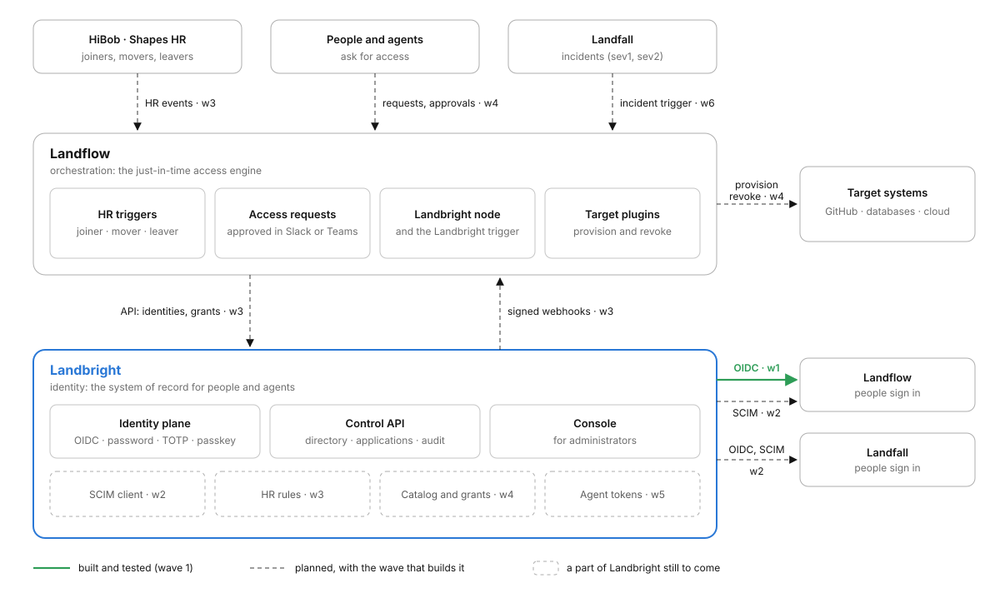
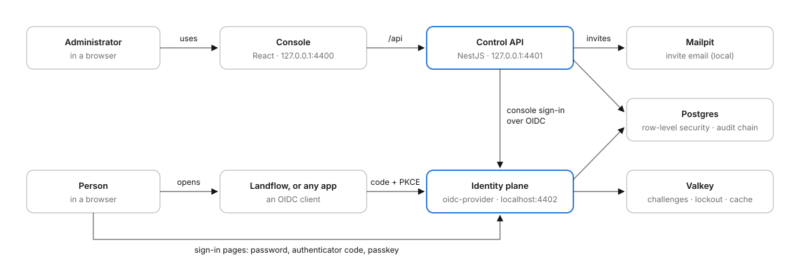

# The suite

How Landbright works with Landflow and Landfall, and what runs inside Landbright today. [plan.md](plan.md) §1 to §3
has the reasoning; this page has the pictures. They are also on the published page with every screen.

## Landbright, Landflow and Landfall



Landbright decides and remembers; Landflow acts.

- **HR events** (HiBob webhooks, Shapes over GraphQL) arrive as Landflow triggers. Joiner, mover and leaver flows call
  Landbright's API to create, change or deactivate the identity and its groups (wave 3).
- **Access requests** from the portal, Slack, Teams or an agent's tool call become Landflow flows: approval where the
  approver works, then provisioning through Landflow's target plugins, and revocation when the grant ends (wave 4).
  Landbright keeps the catalog, the policies and the ledger of grants, and enforces the end even if Landflow is down.
- **Signed webhooks** tell Landflow what changed in Landbright (`request.created`, `grant.expiring`,
  `identity.deactivated`, …) through the Landbright trigger (wave 3).
- **Sign-in**: Landflow and Landfall are OIDC relying parties of Landbright, with group names in the `roles` claim.
  This is the only edge built today (wave 1); SCIM pushes to both follow in wave 2.
- **Agents** get Landbright identities with an accountable sponsor; in wave 5 a run started by a person gets a token
  whose subject is the person and whose `act` claim names the agent.
- **Landfall incidents** (sev1, sev2) start a Landflow flow that grants the responders a pre-approved bundle until the
  room closes (wave 6). Landfall itself executes nothing.

## Inside Landbright today



[architecture.md](architecture.md) has the code map behind each box, and [development.md](development.md) the ports.

## Try it: Landflow signs in through Landbright

The real Landflow, unchanged, as a relying party of the development Landbright (`pnpm serve`). It runs from Landflow's
own image as a throwaway instance with its own data, so the Landflow you use day to day isn't touched. Screens:
[screens.md](screens.md#in-the-real-landflow).

1. Build Landflow's image in the Landflow repository (`landflow/host:dev`, its `docs/deployment.md`).
2. In Landbright's console, **Applications → Register**: name *Landflow*, client id `landflow-local`, redirect URL
   `http://localhost:57300/api/auth/oidc/callback`. Copy the secret.
3. **Groups**: *Landflow Admins* and *Landflow Editors*, with people in them. Group names are the `roles` claim.
4. An env file (mode 600, outside the repository):

   ```bash
   LANDFLOW_OIDC_ISSUER=http://localhost:4402/oidc
   LANDFLOW_OIDC_CLIENT_ID=landflow-local
   LANDFLOW_OIDC_CLIENT_SECRET=<the secret>
   LANDFLOW_OIDC_SCOPES=openid email profile roles
   LANDFLOW_OIDC_ROLE_MAP=Landflow Admins=admin,Landflow Editors=member
   LANDFLOW_OIDC_DEFAULT_ROLE=none
   LANDFLOW_OIDC_LABEL=Sign in with Landbright
   ```

5. `LANDFLOW_OIDC_ENV_FILE=<that file> docker compose -f deploy/landflow/compose.yml up -d --wait`, then open
   http://localhost:57300 and choose *Sign in with Landbright*. `docker compose -f deploy/landflow/compose.yml down -v`
   removes it.

The container uses host networking so `http://localhost:4402` is the same issuer for the browser and for Landflow's
back channel. `LANDFLOW_OIDC_DEFAULT_ROLE=none` makes Landflow refuse anyone in neither group.

What the live check showed (wave 1): the administrator arrives as a Landflow admin and Tal as a member, both marked as
single sign-on users; once Tal is deactivated in Landbright, Landbright refuses the password. A Landflow session that
already exists stays open until it ends: Landflow hears about deactivation only when SCIM or the webhooks arrive
(waves 2 and 3).
