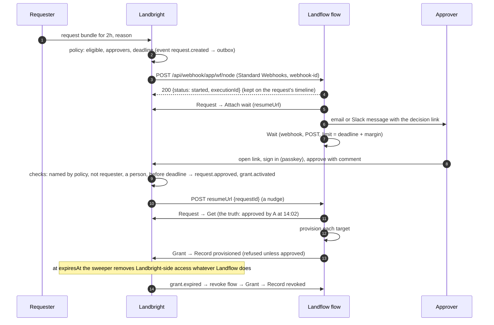

# Plan 003: Access requests, the Landbright Trigger, and approval flows in Landflow

**Spec**: [spec.md](spec.md) · **Date**: 2026-11-12 · **Status**: proposed, reviewed against Landflow's live source

## Summary

Landbright owns requests, policies, decisions and grants. Landflow learns about them through a **Landbright Trigger**
(an app webhook trigger in a new `landbright` plugin) that registers its own subscription when the flow is published,
and talks back through a **Landbright** node with client-credentials. The approval conversation runs in Landflow with
nodes it already has (a message with a decision link, then a Wait); the decision is made and recorded in Landbright,
where the approver signs in, so the rule "a person the policy names approves" is checked where the ledger lives.
A native **Approval** node in Landflow (Slack buttons, email, the *Needs you* inbox) comes after, as a Landflow change,
and relays decisions to Landbright for bundles whose policy accepts a decision made in chat.

## What Landflow has today (checked 2026-11-12, working tree)

| Capability | In Landflow | Source |
|---|---|---|
| App webhook triggers | `triggerSource: "appWebhook"`; `webhookMethods { checkExists, create, delete }` run on publish, unpublish, rollback and delete (and at boot on the leader); failed creates retry 1 min → 1 h; per-node static data holds the hook id and secret | `docs/protocol.md` §12 (476–549), `packages/sdk/src/webhooks.ts:28–77`, `apps/web/src/lib/server/app-webhooks.ts` |
| Delivery URL | `${LANDFLOW_PUBLIC_URL}/api/webhook/app/<workflowId>/<nodeId>`, public, raw body to the plugin, waits for a create in flight; answers `{status:"started", executionId}` or `duplicate` | `app/api/webhook/app/[workflowId]/[nodeId]/route.ts`, `app-webhooks.ts:130` |
| Dedup | The plugin returns `idempotencyKey`; repeats within 24 h answer `duplicate` | `idempotency.ts:12–16`, `runner.ts:391–396` |
| Signatures | SDK helpers for GitHub, Stripe, Slack and plain HMAC-SHA256; **no Standard Webhooks helper** | `packages/sdk/src/signatures.ts` |
| Example to copy | GitHub Webhook Trigger: creates the hook with a random secret, stores `{webhookId, webhookSecret}`, verifies, `idempotencyKey` = delivery id | `plugins/productivity/productivity/github.py:659–797` |
| Plugin template | `plugins/landfall` (TypeScript: `definePlugin`, credential type, fake server, tests, `flows/`); its trigger **polls** | `plugins/landfall/src/nodes/landfall-trigger.ts:46` |
| OAuth client credentials | Host credential `core.oAuth2Api` with `grantType: clientCredentials`, Basic or body auth, token renewed by the host; a plugin credential `extends: ['oAuth2Api']`. No `private_key_jwt`. No plugin uses client credentials yet | `docs/protocol.md:303–344`, `credentials/vault.ts:648–686` |
| Approvals | **None for a workflow run.** AI Agent tool approvals (Slack buttons, signed single-use email links, editor) and four-eyes publishing exist; Teams cards only for standalone agents. Roadmap: "What remains: approvals from a workflow run (a pause that waits, like Wait for Approval)" | `lib/server/approvals.ts`, `governance/approvals.ts`, `docs/roadmap.md:804` |
| Waiting | Wait node: `webhook` or `form` resume, `limitWaitTime`; one output (on timeout it passes its input through); durable across restarts; no maximum | `nodes/flow.ts:272–451`, `waits.ts` |
| Resume URL | `$execution.resumeUrl` = `/api/waiting/<executionId>`: **public, no auth, GET by default**; the execution id is the only secret | `app/api/waiting/[id]/route.ts`, `lib/shared/auth-paths.ts:42` |
| Pausing from a plugin | Only in-process (host) nodes can call `ctx.putExecutionToWait`; **a remote plugin node can't wait** | `docs/protocol.md` §10 (370–400) |
| Shipping flows | `plugins/<p>/flows/*.json`, listed in the marketplace entry, become instance templates on install | `docs/marketplace.md:128–143` |
| Specs | `docs/specs/NN-name.md`; latest 17, so the next is 18 (the folder is new and uncommitted: another session is writing it) | `docs/specs/README.md` |

## Design review: what changes in the earlier plan

| The plan said | The source says | So |
|---|---|---|
| The `landbright` plugin is "laid out like `plugins/landfall`" with a webhook trigger | The Landfall Trigger polls | Copy Landfall's layout, credential and fake; copy the trigger from the GitHub Webhook Trigger |
| Deliveries signed with Standard Webhooks | No SDK helper | The plugin verifies `v1,` signatures itself (HMAC-SHA256 over `id.timestamp.body`, 5-minute tolerance, several signatures during rotation), about 40 lines with tests; a later SDK helper is optional |
| L1: an Approval node "reusing the AI Agent's tool-approval machinery" | Only host nodes can pause; tool approvals are tied to `wait.data.approval` of the AI Agent | L1 is a **host** node in `apps/web` (a Landflow spec), not part of the plugin. Until then: Wait + decision in Landbright |
| Fallback: a Wait on `$execution.resumeUrl` "which Landbright's inbox calls" | The resume URL is public and unauthenticated | The resume call is a **nudge, never the decision**: after resuming, the flow re-reads the request from Landbright with its own credential. Provisioning callbacks are refused unless Landbright holds an approval |
| Approval channels Slack, Teams, email | Teams cards don't reach workflow runs | Phase 4 covers Slack, email and the *Needs you* inbox; Teams after |

## Who owns what

```
Landbright (decides, remembers)                  Landflow (acts)
  catalog: bundles, entitlements                   Landbright Trigger: one run per event
  policy: eligibility, approvers, durations          Landbright node: read requests, attach a wait,
  requests, decisions, grants (event-sourced)          record provisioned / revoked, (phase 4) relay decisions
  decision page (approver signs in)                 the conversation: Slack, email, forms, Wait
  deadlines, expiry sweeper (the backstop)          provisioning and revoke flows per target
  outbox → signed deliveries, retries              templates the customer edits on the canvas
```

## The flow



A second flow can take `grant.activated` / `grant.expired` instead of continuing in the approval flow; the templates
ship both shapes, and the per-target provisioning flows are reused by every bundle that needs that target.

## Landbright: what gets built

**Catalog and policy (minimal for this feature, wave 4 grows it).**
`bundle` (name, entitlements: for now Landbright groups only, owner, policy), `policy` (version; eligible groups;
approvers: groups, the requester's manager, the bundle owner; `approvalsRequired` 1 by default; `maxDuration`,
`defaultDuration`; `decisionDeadline`; `expiringNotice` 15 min; `requires`: reason, ticket;
`decisionChannels`: `landbright` (default) and, from phase 4, `chat`).

**Requests, decisions, grants as an event log** (principle V): `access_event` (append-only, per tenant, hash-chained
like the audit log, with an advisory lock per request), projected into `access_request` and `grant`. Request numbers are
human-readable per tenant (`REQ-128`). Every decision event carries who, through which channel
(`landbright` | `chat:slack` | `chat:email` | `landflow-inbox`), with what assurance (`signed-in` | `chat`), and, when
relayed, which service relayed it.

**Decision rules, enforced in one place** (`decide()` in `apps/control`): the decider is an active person (never an
agent or a service); named by the policy; not the requester or the subject; the request is still pending and before its
deadline; the channel is one the policy accepts. Anything else is refused and audited.

**Outbox and deliveries.** `outbox_event` written in the same transaction as the access event; a delivery worker under
a Valkey lock (principle VII) sends to each matching subscription with Standard Webhooks headers, retries with
exponential back-off for 24 h (5 s → 1 h), then marks the delivery failed. `webhook_delivery` keeps status, attempts,
the response code and Landflow's `executionId`. Order isn't guaranteed; payloads say so and link to the resource.

**Subscriptions API** (what the trigger's `checkExists` / `create` / `delete` call): `POST /api/v1/webhooks`
`{url, events[], filter: {bundleIds?}, description}` → `{id, secret}` (the secret shown once, then sealed);
`GET` / `DELETE /api/v1/webhooks/:id`. URLs are allowed only for origins an administrator registered with the
application (`allowedWebhookOrigins` on Landflow's client), which also bounds where resume nudges go (no SSRF).

**Machine API for Landflow.** Today the control API serves the console's session only. New: `/api/v1/*` accepts a
bearer access token from Landbright's own issuer (client credentials, `resource` = the control API, JWT access tokens
via oidc-provider's resource indicators), with scopes `requests:read`, `requests:relay-decision` (phase 4),
`grants:record`, `webhooks:manage`. Routes: `GET /api/v1/requests/:id`, `POST /api/v1/requests/:id/waits`
`{resumeUrl}`, `POST /api/v1/requests/:id/decisions` (phase 4, relay only), `POST /api/v1/grants/:id/targets/:target`
`{status: provisioned | failed | revoked, detail}`. Every call is audited as "Landflow (service)".

**Decision page and portal.** Approvers aren't administrators, so the console gains a portal for every signed-in
person: *My requests*, *To decide*, and `/decide/REQ-128` (sign in with Landbright, see requester, bundle, duration,
reason, policy, then Approve / Deny with a comment). The request form lives there too.

**Sweeper.** Under the same lock as deliveries: expires undecided requests at their deadline (`request.decided`,
`expired`), sends `grant.expiring`, and at `expiresAt` removes the Landbright-side entitlements (group membership),
emits `grant.expired`, and keeps re-sending until each target is recorded revoked; a grant past its end with a target
not revoked shows on Home.

## Landflow: what gets built (a Landflow spec, filed with the user's go-ahead)

**`plugins/landbright`** (TypeScript, remote; layout of `plugins/landfall`, port pair after the last used):

- Credential **Landbright API** (`landbrightApi`, `extends: ['oAuth2Api']`, pinned `grantType: clientCredentials`,
  Basic auth, token URL from the issuer's discovery, scopes as above).
- **Landbright Trigger** (`appWebhook`): events multi-select, optional bundle filter. `create` calls
  `POST /api/v1/webhooks` with `ctx.getWebhookUrl()` and keeps `{webhookId, secret}` in static data; `checkExists`
  `GET`s it; `delete` removes it. `webhook` verifies the Standard Webhooks signature and timestamp (401 otherwise),
  returns one item (the event's `data` plus `type`, `deliveryId`) and `idempotencyKey` = `webhook-id`.
- **Landbright** node: Request → Get, Attach wait, Comment; Grant → Get, Record provisioned, Record failed, Record
  revoked; Identity → Get (for messages: name, manager, Slack-able email). Usable as an AI tool for reads only.
- `test/fake-landbright.ts` (subscriptions, signed deliveries, requests) and tests in the style of
  `plugins/messaging/test/slack-trigger.test.ts` and `apps/web/test/app-webhooks.test.ts`.
- `flows/`: **Approve a request by email**, **Approve a request in Slack** (message with the decision link; Wait,
  webhook POST, limit; Request → Get; Switch on status), **Provision and revoke a Landflow project role** (the first
  target), installed as templates through the marketplace entry.
- Docs by Landflow's rules: plugin README, `docs/protocol.md` §12 example list, `features/integrations.md`,
  `limitations.md`, `roadmap.md`, `development.md`, `history.md`, `README.md`.

**Phase 4, Landflow spec: a workflow Approval node** (host node in `apps/web`, closing the roadmap's "approvals from
a workflow run"): ask in Slack (buttons), email (signed single-use links with a confirmation page), the editor and the
*Needs you* inbox; approvers by Landflow user, email or Slack user; timeout; **three outputs** *approved* / *denied* /
*timed out*, each carrying who decided and how. It builds on the AI Agent's approval store and Slack interaction
handler rather than the public resume URL. With it, the Landbright node gains Request → **Relay decision**, and
Landbright accepts it for policies whose `decisionChannels` include `chat`, verifying the named approver by email
(Slack's verified email, or the Landflow user's), never the service's own say-so.

## Decisions

- **The decision lives in Landbright.** Landflow runs the conversation and may relay a person's answer (phase 4);
  it never decides. Same split as Okta's delegated flows and ConductorOne's/Entitle's approval webhooks; required by
  principle IV.
- **Push, not poll.** A webhook trigger starts a run within seconds and Landflow already reconciles subscriptions on
  publish; polling (the Landfall Trigger's way) would add latency to every approval.
- **Standard Webhooks, with thin-but-useful payloads and a re-read.** Principle VI; the snapshot keeps simple flows
  simple, and the re-read makes late, duplicate or forged messages harmless.
- **The resume URL is a nudge.** It is public; Landbright posts only an id to it, and the flow re-reads.
- **The sweeper is the backstop.** Expiry never depends on Landflow being up (plan §4.2).
- **Phase 1 needs no Landflow host change**: one new plugin plus templates. The Approval node is a separate, larger
  Landflow change that improves the experience without changing the trust model.

## Constitution Check

| Principle | Status | Evidence |
|---|---|---|
| I. Adopt plumbing | PASS | oidc-provider's client credentials and resource indicators for the machine API; Standard Webhooks wire format; Landflow's app-webhook lifecycle (`app-webhooks.ts`) and Wait node, not new engines |
| II. Default deny | PASS | `/api/v1` needs a bearer token with a scope per route; subscription URLs limited to registered origins; every grant has `expiresAt`; the decision page needs a Landbright session |
| III. Accountable human | PASS | Agents may request (later phases) but each request names a person sponsor; deciders are people only |
| IV. Policy or a person approves | PASS | `decide()` checks the decider is an active person named by the policy, not the requester; Landflow's service identity can't decide; relayed decisions (phase 4) name and verify the person |
| V. Event-sourced ledger | PASS | `access_event` append-only and hash-chained; requests and grants are projections; deliveries leave through `outbox_event` in the same transaction |
| VI. Standards on the wire | PASS | Standard Webhooks; OAuth 2.0 client credentials with RFC 8707 resource indicators; JWT access tokens (RFC 9068) |
| VII. N-up safe | PASS | Delivery worker and sweeper under a Valkey lock; per-request advisory lock for decisions (first valid decision wins) |
| VIII. Spec-driven | PASS | This spec; unit tests for `decide()` and signatures; route tests for `/api/v1`; e2e: request → delivery to a fake Landflow app-webhook endpoint → decision page → nudge → re-read → provisioned → expiry; a live check with the real Landflow from `deploy/landflow/compose.yml` |
| IX. Local only | PASS | Mail to Mailpit; Landflow from its local image; Slack only if the user connects a workspace |

## Phases and the first slice

| Phase | Builds | Done when |
|---|---|---|
| **1. Ledger and policy** (Landbright) | Bundles (group entitlements), policies, requests, decisions, grants as events; `decide()`; the portal with the request form and decision page; the sweeper; console Requests and Grants pages | A request is approved on the decision page, Tal is in the group until expiry, then not; the timeline replays it |
| **2. Events out** (Landbright) | Outbox, subscriptions API, delivery worker with retries and a delivery log, the machine API with client credentials and scopes, resume nudges | A test receiver gets signed `request.created`, re-reads it with a token, and is nudged on the decision |
| **3. The `landbright` plugin** (Landflow, separate spec) | Credential, trigger, node, fake, three flow templates, docs | **First slice**: the spec's acceptance, live, with the real Landflow: request → email via Landflow → decide in Landbright → flow resumes and records provisioned → expiry → revoke flow |
| **4. Approval node** (Landflow host, separate spec) + relayed decisions (Landbright) | Slack buttons, email links, *Needs you*; Request → Relay decision; `decisionChannels: chat` | An approver clicks Approve in Slack (a connected workspace) for a chat-allowed bundle; Landbright records "Dana, via Slack, relayed by Landflow" |

Phases 1–2 are Landbright work this repository can do now. Phase 3 and 4 change Landflow's repository and are written
as Landflow specs (18 and 19 at the time of writing) only with the user's go-ahead, coordinated with the session
working there.

**Targets.** The first slice provisions only what Landbright controls itself (group membership, which reaches Landflow
as the `roles` claim at the next sign-in). Real-time effect in Landflow needs SCIM push (wave 2), which also gives
`project:Data:editor` grants through `LANDFLOW_SCIM_GROUP_MAP`. Other targets (GitHub teams, Postgres roles) are
provisioning flows in Landflow, added per target.

## Risks

| Risk | What we do |
|---|---|
| A forged or replayed resume call or delivery | Resume carries only an id and the flow re-reads; deliveries verified by signature and a 5-minute timestamp window, deduplicated by `webhook-id` (Landflow keeps keys 24 h) |
| Two published flows both handle the same request | Allowed (one may only log); decisions are first-valid-wins under a lock, and provisioning callbacks are idempotent per target |
| Landflow down at decision time | Deliveries retry 24 h; the deadline and expiry are Landbright's; the request page shows what's pending |
| Ownership confusion between Landbright's policy and the flow's logic | The flow can't approve; anything a flow decides (who to message, when to remind) is presentation. Policies are versioned and the request records the version |
| Approvals in chat are weaker than a signed-in decision | Phase 4 only, opt-in per policy, recorded with `assurance: chat`; high-risk bundles keep `landbright` only |
| Landflow's `docs/specs/` is being written by another session | File the Landflow specs only after asking, and read its index first |

## Open decisions for the user

1. **Decision surface for the first slice**: Landbright's decision page (recommended: no Landflow host change, strongest
   identity) or build Landflow's Approval node first.
2. **Chat approvals**: accept a Slack or email click as a decision for low-risk bundles (phase 4), or always require a
   signed-in decision in Landbright?
3. **Order with SCIM**: build wave 2's SCIM push before this, so grants take effect in Landflow at once, or start with
   group membership and the `roles` claim (recommended: start here, SCIM in parallel).
4. **Landflow specs**: may I write the `landbright` plugin and the Approval node as specs in `landflow/docs/specs/`,
   given the other session there?

## Sources

- Landflow working tree, paths above (read 2026-11-12).
- Okta Identity Governance, approval sequences that call delegated Okta Workflows:
  https://help.okta.com/en-us/Content/Topics/identity-governance/access-requests/rcar-approval-seq-edit.htm
- ConductorOne webhooks (approve or deny from a request policy): https://www.conductorone.com/docs/product/admin/webhooks
- Entitle approval workflows (approval webhook, reply endpoint): https://docs.beyondtrust.com/entitle/docs/approval-workflows
- Apono request webhooks to Okta Workflows and Torq, webhooks as custom approvers:
  https://docs.apono.io/docs/webhook-integrations/request-webhook ·
  https://docs.apono.io/docs/webhook-integrations/manual-webhook/validate-tickets-with-webhooks
- Standard Webhooks: https://www.standardwebhooks.com/
